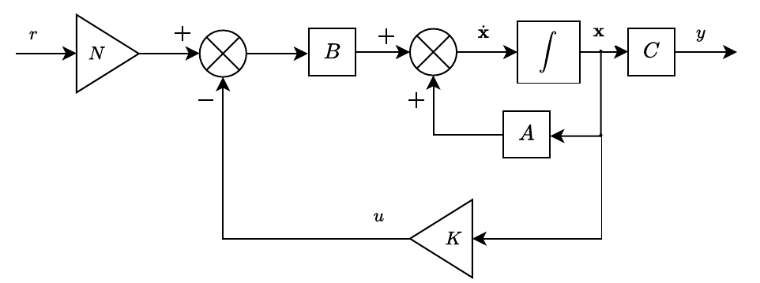
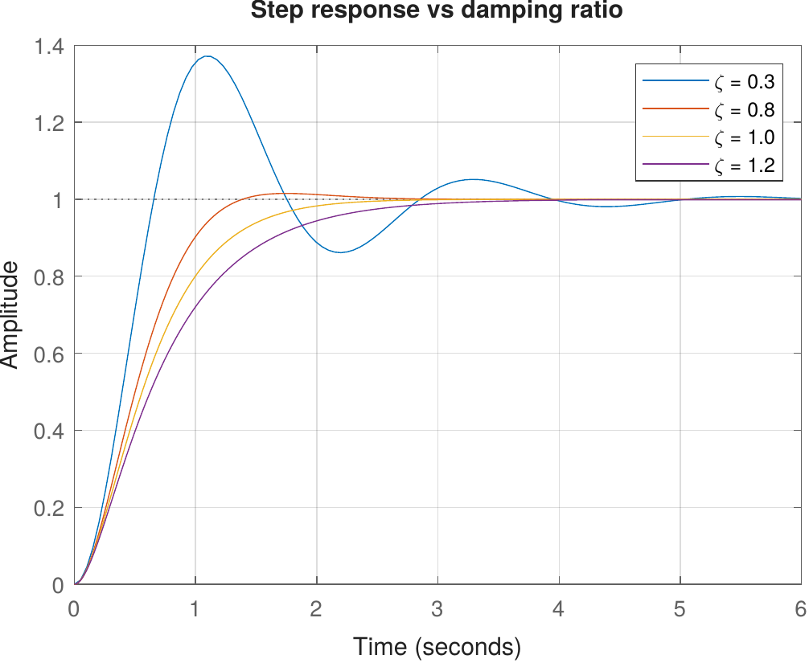

*A simple second-order system, four damping ratios, and overshoots of the system reveal something interesting!*

Every control course teaches $\zeta$, the damping ratio. Fewer courses show you what it does on a plant you can simulate in ten lines. So let's do that.

## The plant

Let us consider a simple second order system: a double integrator whose transfer function is provided in @eq-sys,

$$
G(s) = \frac{1}{s^2}
$$ {#eq-sys}

This system behaves like a mass driven by a force: the state variable, position is the integral of velocity, and velocity is the integral of applied force. As no friction is assumed, this system never settles. Note that both poles of this system are located at the origin.

In state-space form, let the state variable be $x = \begin{bmatrix} x_1 & x_2 \end{bmatrix}^{\top}$, where $x_1$ be the position, $x_2 = \dot x_1$ be the velocity, $u$ be the applied force, which causes acceleration ($\dot x_2$) of the mass, and the output $y$ be the position ($x_1$).

$$
\begin{bmatrix} \dot{x_1} \\ \dot{x_2} \end{bmatrix} = \begin{bmatrix} 0 & 1 \\ 0 & 0 \end{bmatrix} \begin{bmatrix} x_1 \\ x_2 \end{bmatrix} + \begin{bmatrix} 0 \\ 1 \end{bmatrix} u
$$ {#eq-state}

$$
y = \begin{bmatrix} 1 & 0 \end{bmatrix} \begin{bmatrix} x_1 \\ x_2 \end{bmatrix}
$$ {#eq-output}

The state-space matrices are provided in @eq-mat

$$
A = \begin{bmatrix} 0 & 1 \\ 0 & 0 \end{bmatrix},\quad
B = \begin{bmatrix} 0 \\ 1 \end{bmatrix},\quad
C = \begin{bmatrix} 1 & 0 \end{bmatrix}.
$$ {#eq-mat}

## The controller

Let us apply state feedback control on @eq-sys, $u = -Kx$, in which position and velocity are measured and used as feedback signals. The block diagram of this control scheme is provided in @fig-block. The closed-loop poles become the eigenvalues of $(A - BK)$. The system is controllable, which can be checked by the controllability matrix $\begin{bmatrix} B & AB \end{bmatrix}$ has full rank ($2$). Because the plant is controllable, $K$ can be chosen to put the poles at any desired place.

{#fig-block width=95%}

For $K = [k_1\ \ k_2]$ the closed-loop characteristic polynomial is

$$
\det\bigl(sI - (A - BK)\bigr) = s^2 + k_2 s + k_1 .
$$

For a target natural frequency $\omega_n$ and damping ratio $\zeta$, the desired polynomial is $s^2 + 2\zeta\omega_n s + \omega_n^2$. Matching coefficients gives

$$
K = \begin{bmatrix} \omega_n^2 & 2\zeta\omega_n \end{bmatrix}
$$ {#eq-K}

The first gain acts like stiffness and the second like damping.

A feed-forward gain $N = k_1$ is added so that the step response settles at the reference value set by $r$ rather than $1/\omega_n^2$.

## The experiment

Let us fix $\omega_n = 3$ rad/s and sweep $\zeta = 0.3,\ 0.8,\ 1.0$ and $1.2$. The full script is on GitHub: <https://github.com/karthiknainar/karthiknainar.github.io/tree/main/posts/zeta-sweep>

```matlab
A = [0 1; 0 0]; B = [0; 1]; C = [1 0]; D = 0;
wn = 3;
for zeta = [0.3 0.8 1.0 1.2]
    p = roots([1 2*zeta*wn wn^2]);
    K = place(A, B, p);
    sys_cl = ss(A - B*K, B*K(1), C, D);
    info = stepinfo(sys_cl);
    fprintf('zeta=%.1f  OS=%.1f%%  Ts=%.2fs\n', ...
        zeta, info.Overshoot, info.SettlingTime);
end
```

{#fig-step width=85%}

## The results

| $\zeta$ | Poles | Overshoot | Settling time (2%) |
|:---:|:---:|:---:|:---:|
| 0.3 | $-0.9 \pm j\,2.86$ | $\approx 37\%$ | 3.74 s |
| 0.8 | $-2.4 \pm j\,1.8$ | $\approx 1.5\%$ | 1.25 s |
| 1.0 | $-3,\ -3$ | 0% | 1.94 s |
| 1.2 | $-1.61,\ -5.59$ | 0% | 2.64 s |

For an underdamped second-order system with no zeros, the overshoot is

$$
\text{OS} = \exp\!\left(\frac{-\pi\zeta}{\sqrt{1-\zeta^2}}\right).
$$

## What the numbers say

- **$\zeta = 0.3$** rings. The poles sit close to the imaginary axis, so the response overshoots heavily and takes a long time to die out.
- **$\zeta = 0.8$** is the sweet spot here: small overshoot and the fastest settling of the four.
- **$\zeta = 1.0$** has no overshoot, but it is slower than $\zeta = 0.8$. The poles are real and repeated at $-3.0$.
- **$\zeta = 1.2$** has no overshoot, but it is slower than $\zeta = 1.0$. The poles are real, and the slow one at $-1.61$ dominates the response. More damping is not always better.

Notice that $0.707$ is **not** critical damping. **Critical damping is $\zeta = 1$.** The value $0.707$ is where the frequency response loses its resonance peak, which gives roughly 4% overshoot. This is the reason it is a popular design target.

## The takeaway

Damping is a trade-off, not a quality score. Moving the poles changes overshoot and speed together, and the right choice depends on what your system can tolerate. $\zeta$ and $\omega_n$ are the two knobs of a second-order loop, and the sweep shows the cost of turning one without watching the other.

*Next time: In this example it is assumed that velocity is measurable. In practice, it often can't be! That calls for an observer.*
